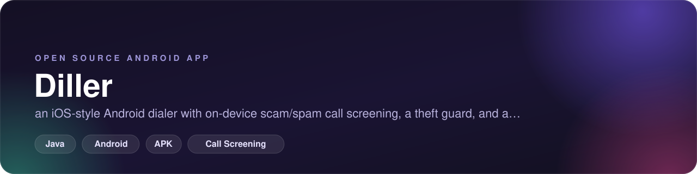

<div align="center">




<a href="https://github.com/technicalnihilist-lgtm/diller/stargazers"></a>&nbsp;<a href="https://github.com/technicalnihilist-lgtm/diller/network/members"></a>

<a href="https://github.com/technicalnihilist-lgtm/diller/releases/latest"></a>

<b>Support the work</b>

  

<sub>Donations aren't live yet — Paytm, UPI, PayPal and Buy&nbsp;Me&nbsp;a&nbsp;Coffee all show <b>coming soon</b>. Until then, a ⭐ star is the best support.</sub>

<a href="https://github.com/technicalnihilist-lgtm/diller/releases/latest"></a>  <a href="https://github.com/technicalnihilist-lgtm/diller/releases"></a>

</div>

---

## What's new in 3.1.0

- **Built-in key support.** `AiConfig` now falls back to a `BuiltinKey` class if the user hasn't saved a key, so a personal build can ship with the AI already working — no setup screen.
- `BuiltinKey.java` is **gitignored**: it is generated only for personal builds and never lands in this public repo.
- The public APK here still ships **without** a key (a key in a public repo would be extracted and abused). Paste your own key in **AI → AI settings**.

## What's new in 3.0.1

- **Fixed the AI model name** — the default was `sarvam-m`, which does not exist on Sarvam's API, so chat failed even with a valid key. Now `sarvam-105b-conversations`.
- **Translation** now sends `model: mayura:v1`, matching Sarvam's `/translate` endpoint.
- Verified against the live API: chat and translate both return 200.

## What's new in 3.0.0 — AI

A new **AI tab** (5th tab) with:

- **Today's call summary** — real numbers from your call log: total calls (outgoing / incoming / missed), talk time, and who you spoke to most ("Soniya — 3 baar"). Runs fully on-device, no key needed.
- **Ask AI** — a chat box wired to your AI provider.
- **Translate** — type text, cycle the target language (Hindi, Bengali, Tamil, Telugu, Marathi, Gujarati, Kannada, Malayalam), translate.
- **AI call agent** — when enabled, Diller answers calls from unknown or suspected-spam numbers on your behalf and records each one.
- **AI history** — local log of every question, translation and call the agent handled.

### Setting up the AI

No model is bundled, so chat and translation need an API key. Open **AI → "AI settings (API key)"** and enter **provider** (`sarvam` or `openai`), your **API key**, **base URL** (default `https://api.sarvam.ai`) and **model** (default `sarvam-m`). Without a key, the call summary and history still work.

### What is NOT possible on Android

Android blocks third-party access to call audio, so two requested features cannot be built by any sideloaded app:

- **Live captions of the other person** — no app gets an audio stream of a call (only the system's Live Caption can).
- **A real two-way AI voice agent** that listens and speaks to the caller — injecting TTS into a call and recording the caller need system privileges.

The AI agent here therefore **answers and logs** the call; it cannot converse.

## What's new in 2.9.0 — iOS 26 Liquid Glass

- **Colourful wallpaper backdrop** so the glass has something to refract (glass on pure black just looks grey).
- **Frosted glass keypad**, **glass dock**, **glass cards** with thin bright rims.

## What's new in 2.8.0

- **Bottom bar matched to the Galaxy-Store-style reference**: four tabs in one bar, **no bar background** (the icons float), and the selected tab sits in a **solid blue capsule** with a **white icon** and a **blue label** — exactly the treatment in the video.
- Action pills are now **blue-tinted glass** instead of neutral.

## What's new in 2.7.0

- **Lens corrected against the video's pixels.** My earlier lens was far too bright (a near-white blob). Measured from the frame, the lens is only ~7% lighter than the bar with a **thin bright rim** — so it now reads as a subtle frosted capsule, exactly like the reference.
- **Proportions fixed**: lens ≈ **1.19×** the item width and **1.19×** the bar height (it was 1.35× before), protruding ~5dp above and below.
- Bar tone matched to the sampled value (~15% white).

## What's new in 2.6.0

- **Bottom bar rebuilt to match the reference frame-for-frame** (measured from the video): a glass **pill holding three tabs** (Calls, Contacts, Keypad) plus a **separate glass circle** for Shield — exactly the video's layout.
- The selected tab gets a **stadium-shaped glass lens** that is ~1.35× the bar height and spills past the bar's top and bottom edges, with a soft (not bright) rim.
- **Blue icon + label** on the selected tab, soft grey on the rest; the lens scales in when you switch.
- Bar/lens tones were sampled from the video (bar ≈13% white, lens ≈22%) so it reads the same.

## What's new in 2.5.0

- **The tab bar now matches the liquid-glass reference.** All four tabs (Calls, Contacts, Keypad, Shield) live in **one floating glass pill**, and the selected tab sits in a **circular glass lens** that is larger than the bar and spills past its edges — with a **blue** icon and label, exactly like the video.
- **Swipe to switch tabs.** Drag left/right anywhere on the screen (including on the bar itself) to move between Calls → Contacts → Keypad → Shield, with a slide animation. Vertical scrolling is unaffected, and a swipe started on a call/contact row still does call/delete.

## What's new in 2.4.0

- **Liquid-glass bottom bar.** The tab bar is now a floating, frosted-glass pill instead of a flat black block — translucent with a bright rim, and the **selected tab sits in a raised glass capsule with a soft cyan glow**. The Shield button is a glass circle too.

## What's new in 2.3.1

- **Swipe gestures actually work now.** 2.3.0 attached the swipe listener to list rows, but ListView rows are not clickable by default, so a row never became the touch target and never received the drag events — the gesture could not fire. Rows are now clickable and own the whole gesture, and taps are handled by the same listener. Swipe **right to call**, **left to delete** (calls immediately, contacts after a confirm).

## What's new in 2.3.0

- **Swipe actions on lists.** In **Calls** and **Contacts**, swipe a row **right to call** that person, or **left to delete** it — a call-log entry is removed immediately, and deleting a contact asks for confirmation first. Vertical scrolling still works normally.

## What's new in 2.2.0

- **Speaker & volume fixed.** The Speaker button now changes the real call audio route (via the Telecom `InCallService`), not just the deprecated system flag — so it actually switches to loudspeaker. Call volume is pushed to maximum when a call connects and when you enable speaker. Mute now uses the proper in-call mute too.
- **Contacts built in.** Adding a contact opens a Diller dialog (name + number) and saves straight to the device — no bouncing out to another contacts app. There's a **+** button on the Contacts tab as well as the keypad's add button.
- **Smaller, iOS-style dial pad.** Keys are now compact circles with generous spacing instead of edge-to-edge tiles.

## Features

- **iPhone-style dialer** — black background, circular dark-grey keys, green call button, and a rounded **Calls / Contacts / Keypad** bar with a round **Shield** button.
- **Liquid-glass call screen** — a frosted, animated glass screen shown while you're on a call: contact, number, live call state (Calling… / Incoming call / running timer), a scam warning, Mute / Speaker, and a red hang-up. Works for incoming *and* outgoing calls.
- **Scam & spam call screening** — a `CallScreeningService` inspects every incoming call on-device and warns you before you pick up. Suspicious callers are tagged red in the call list.
- **Blocklist** — add numbers; blocked callers are rejected automatically.
- **Built-in contact creation** — create contacts inside Diller.
- **Swipe to call / delete** — swipe a row right to call, left to delete (calls or contacts).
- **Swipe to switch tabs** — drag left/right on the screen or the bar.
- **Theft Guard** — detects a SIM-card swap or repeated failed unlock attempts, sounds a loud alarm, and (with device-admin) can lock the device. Restarts after reboot.
- **Missed-call filter**, search, and a clean call log.

## Install

Download **[Diller.apk](https://github.com/technicalnihilist-lgtm/diller/releases/latest/download/Diller.apk)**, copy it to your phone, and tap it. Allow *"install from this source"* when Android asks, then open Diller and grant the permissions.

- Package: `com.diller.app`
- Version: 3.1.0 (versionCode 15) · Min Android 8.0 (API 26) · Target Android 14 (API 34)
- Signed with APK Signature Scheme v2 + v3 (self-signed — not a Play Store listing).

## Making Diller your default Phone app (needed for the call screen)

Android only lets an app show **its own in-call screen if it is the default Phone app**. If another dialer is set as default, pressing call hands the call to *that* dialer and Diller's screen won't appear.

Open Diller — the Keypad shows a **"Set Diller as your default Phone app"** banner until you switch. Tap it and pick **Diller**. From then on every call opens Diller's liquid-glass call screen.

Diller qualifies for the role: it handles the `ACTION_DIAL` intent and implements an `InCallService` with both incoming and ongoing call UI.

## How the scam detection works

On-device and heuristic: your blocklist, high-risk international prefixes, telemarketing/promotional series (140, 1800), premium-rate numbers (0900), and repeated/sequential digit patterns — scored 0–100.

It does **not** query a global crowd-sourced scammer database (that needs a network service/account, which this app deliberately avoids), so a brand-new scam number with a normal pattern won't be flagged until you block it. Nothing about your calls leaves the phone.

## Build from source

Plain Android app — **no Gradle**. `build.sh` drives the SDK build-tools directly:

```
aapt2 compile → aapt2 link (+R.java) → javac → d8 → zip → zipalign → apksigner
```

Requirements: JDK 17 (`JAVA_HOME`) and an Android SDK (`ANDROID_HOME`) with `build-tools;34.0.0` and `platforms;android-34`. Then:

```bash
bash build.sh
## Project layout

```
app/AndroidManifest.xml
app/res/…                        layouts, drawables, iOS theme, adaptive icon
app/src/com/diller/app/
    MainActivity.java            tabs, keypad, calls, contacts, shield, roles, banner
    InCallActivity.java          liquid-glass call screen (state + timer + audio routing)
    DillerInCallService.java     InCallService — telecom bridge + full-screen fallback
    DillerScreeningService.java  CallScreeningService — scam/spam screening
    SpamEngine.java              on-device scoring + blocklist
    TheftGuardService.java       foreground anti-theft watchdog + alarm
    AdminReceiver.java           device-admin: failed-unlock alarm, lock/wipe
    BootReceiver.java            restarts Theft Guard after reboot
    GlassBackgroundView.java     animated glass backdrop
    Contacts.java                reverse number lookup
build.sh                         the build pipeline
screenshots/                     design renders + device photos
Diller.apk                       ready-to-install build
```

## Notes

- Self-signed build, not distributed through the Play Store.
- `screenshots/` shows design renders of the current build plus real device photos of the earlier 1.0 build.

## License

MIT — see [LICENSE](LICENSE).

---

---

## 🌍 Languages

<sub>Donations are <b>coming soon</b> in every language below — nothing to pay today, nothing to click.</sub>

<div align="center">

<sub><b>हिन्दी · বাংলা · मराठी · తెలుగు · தமிழ் · ગુજરાતી · ಕನ್ನಡ · മലയാളം · ਪੰਜਾਬੀ · ଓଡ଼ିଆ · অসমীয়া · اردو</b></sub>

</div>

<details>
<summary><b>🌍 Open the same message in 53 languages</b></summary>

**🇮🇳 Indian languages**

- **हिन्दी** (Hindi) — ☕ जल्द ही आ रहा है। · ⭐ अगर आपको यह ऐप और हमारा काम पसंद है, तो कृपया रिपॉजिटरी को स्टार दें और हमें फॉलो करें।
- **বাংলা** (Bengali) — ☕ খুব শিগগিরই আসছে। · ⭐ যদি আপনার এই অ্যাপ এবং আমাদের কাজ ভালো লাগে, তবে অনুগ্রহ করে রিপোজিটরিটিকে একটি স্টার দিন এবং আমাদের ফলো করুন।
- **मराठी** (Marathi) — ☕ लवकरच येत आहे. · ⭐ जर तुम्हाला हे ॲप आणि आमचं काम आवडलं असेल, तर कृपया रिपॉझिटरीला स्टार द्या आणि आम्हाला फॉलो करा.
- **తెలుగు** (Telugu) — ☕ త్వరలో రాబోతోంది. · ⭐ మీకు ఈ యాప్, మా పని నచ్చితే, దయచేసి రిపోజిటరీకి ఒక స్టార్ ఇచ్చి మమ్మల్ని ఫాలో అవ్వండి.
- **தமிழ்** (Tamil) — ☕ விரைவில் வருகிறது. · ⭐ உங்களுக்கு இந்த ஆப்பும் எங்க வேலையும் பிடிச்சிருந்தா, தயவுசெஞ்சு இந்த ரெபாசிட்டரிக்கு ஒரு ஸ்டார்…
- **ગુજરાતી** (Gujarati) — ☕ ટૂંક સમયમાં આવી રહ્યું છે. · ⭐ જો તમને આ એપ અને અમારું કામ ગમતું હોય, તો પ્લીઝ રિપોઝિટરીને સ્ટાર આપો અને અમને ફોલો કરો.
- **ಕನ್ನಡ** (Kannada) — ☕ ಶೀಘ್ರದಲ್ಲೇ ಬರುತ್ತಿದೆ. · ⭐ ನಿಮಗೆ ಈ ಆ್ಯಪ್ ಮತ್ತು ನಮ್ಮ ಕೆಲಸ ಇಷ್ಟವಾದರೆ, ದಯವಿಟ್ಟು ರೆಪೊಸಿಟರಿಗೆ ಸ್ಟಾರ್ ಕೊಡಿ ಮತ್ತು ನಮ್ಮನ್ನು ಫಾಲೋ ಮಾಡಿ.
- **മലയാളം** (Malayalam) — ☕ ഉടൻ വരുന്നു. · ⭐ നിങ്ങൾക്ക് ഈ ആപ്പും ഞങ്ങളുടെ പ്രവർത്തനവും ഇഷ്ടപ്പെട്ടെങ്കിൽ, ദയവായി റെപ്പോസിറ്ററിക്ക് ഒരു സ്റ്റാർ…
- **ਪੰਜਾਬੀ** (Punjabi) — ☕ ਜਲਦੀ ਆ ਰਿਹਾ ਹੈ। · ⭐ ਜੇ ਤੁਹਾਨੂੰ ਇਹ ਐਪ ਅਤੇ ਸਾਡਾ ਕੰਮ ਪਸੰਦ ਹੈ, ਤਾਂ ਕਿਰਪਾ ਕਰਕੇ ਰਿਪੋਜ਼ਟਰੀ ਨੂੰ ਸਟਾਰ ਦਿਓ ਅਤੇ ਸਾਨੂੰ ਫਾਲੋ ਕਰੋ।
- **ଓଡ଼ିଆ** (Odia) — ☕ ଖୁବ୍ ଶୀଘ୍ର ଆସୁଛି। · ⭐ ଯଦି ଆପଣଙ୍କୁ ଏହି ଆପ୍ ଏବଂ ଆମର କାମ ଭଲ ଲାଗୁଛି, ତେବେ ଦୟାକରି ରିପୋଜିଟୋରୀକୁ ଗୋଟିଏ ଷ୍ଟାର୍ ଦିଅନ୍ତୁ ଏବଂ ଆମକୁ ଫଲୋ କରନ୍ତୁ।
- **অসমীয়া** (Assamese) — ☕ অতি সোনকালেই আহি আছে। · ⭐ যদি আপুনি এই এপটো আৰু আমাৰ কাম ভাল পায়, তেন্তে অনুগ্ৰহ কৰি ৰিপজিটৰীটোক এটা ষ্টাৰ দিয়ক আৰু আমাক ফ'ল' কৰক।
- **اردو** (Urdu) — ☕ جلد آرہا ہے۔ · ⭐ اگر آپ کو یہ ایپ اور ہمارا کام پسند آئے تو براہ کرم ریپازٹری کو سٹار دیں اور ہمیں فالو کریں۔
- **संस्कृतम्** (Sanskrit) — ☕ शीघ्रमेव आगच्छति।
- **मैथिली** (Maithili) — ☕ जल्दिये आबि रहल अछि।
- **कोंकणी** (Konkani) — ☕ रोखडेंच येता.
- **کٲشُر** (Kashmiri) — ☕ جَلدی یِوان چھُ۔
- **سنڌي** (Sindhi) — ☕ जल्द अची रह्यो आहे।
- **डोगरी** (Dogri) — ☕ जल्दी आ करदा ऐ।
- **ꯃꯤꯇꯩ ꯂꯣꯟ** (Manipuri) — ☕ ꯑꯊꯨꯕꯥ ꯃꯇꯝꯗꯥ ꯂꯥꯛꯀꯅꯤ꯫
- **बर’** (Bodo) — ☕ थाबैनो फैगोन।
- **ᱥᱟᱱᱛᱟᱲᱤ** (Santali) — ☕ ᱞᱚᱜᱚᱱ ᱦᱤᱡᱩᱜ ᱠᱟᱱᱟ᱾
- **नेपाली** (Nepali) — ☕ छिट्टै आउँदैछ। · ⭐ यदि तपाईंलाई यो एप र हाम्रो काम मन पर्‍यो भने, कृपया रिपोजिटरीलाई स्टार दिनुहोस् र हामीलाई फलो गर्नुहोस्।

**🌍 World languages**

- **العربية** (Arabic) — ☕ قريبًا. · ⭐ إذا أعجبك هذا التطبيق وعملنا، فيرجى منح المستودع نجمة ومتابعتنا.
- **简体中文** (Chinese (Simplified)) — ☕ 即将推出。
- **繁體中文** (Chinese (Traditional)) — ☕ 即將推出。
- **Čeština** (Czech) — ☕ Již brzy.
- **Dansk** (Danish) — ☕ Kommer snart.
- **Nederlands** (Dutch) — ☕ Binnenkort beschikbaar. · ⭐ Vind je deze app en ons werk leuk?
- **Filipino** (Filipino) — ☕ Malapit na.
- **Suomi** (Finnish) — ☕ Tulossa pian.
- **Français** (French) — ☕ Bientôt disponible. · ⭐ Si cette application et notre travail vous plaisent, mettez une étoile au dépôt et suivez-nous.
- **Deutsch** (German) — ☕ Bald verfügbar. · ⭐ Wenn dir diese App und unsere Arbeit gefallen, gib dem Repository einen Stern und folge uns.
- **Ελληνικά** (Greek) — ☕ Έρχεται σύντομα.
- **עברית** (Hebrew) — ☕ בקרוב.
- **Magyar** (Hungarian) — ☕ Hamarosan.
- **Bahasa Indonesia** (Indonesian) — ☕ Segera hadir. · ⭐ Jika kamu suka aplikasi ini dan karya kami, beri bintang pada repositori ini dan ikuti kami.
- **Italiano** (Italian) — ☕ In arrivo.
- **日本語** (Japanese) — ☕ 近日公開。 · ⭐ このアプリと私たちの仕事が気に入ったら、リポジトリにスターを付けてフォローしてください。
- **한국어** (Korean) — ☕ 곧 공개됩니다. · ⭐ 이 앱과 저희 작업이 마음에 드신다면 저장소에 스타를 눌러 주시고 팔로우해 주세요.
- **Bahasa Melayu** (Malay) — ☕ Akan datang.
- **Norsk** (Norwegian) — ☕ Kommer snart.
- **فارسی** (Persian) — ☕ به‌زودی.
- **Polski** (Polish) — ☕ Wkrótce. · ⭐ Jeśli podoba Ci się ta aplikacja i nasza praca, daj repozytorium gwiazdkę i obserwuj nas.
- **Português** (Portuguese) — ☕ Em breve.
- **Română** (Romanian) — ☕ În curând.
- **Русский** (Russian) — ☕ Скоро. · ⭐ Если вам нравится это приложение и наша работа, поставьте звёздочку репозиторию и подпишитесь на нас.
- **Español** (Spanish) — ☕ Muy pronto. · ⭐ Si te gusta esta app y nuestro trabajo, dale una estrella al repositorio y síguenos.
- **Kiswahili** (Swahili) — ☕ Inakuja hivi karibuni.
- **Svenska** (Swedish) — ☕ Kommer snart.
- **ไทย** (Thai) — ☕ เร็ว ๆ นี้
- **Türkçe** (Turkish) — ☕ Çok yakında.
- **Українська** (Ukrainian) — ☕ Незабаром.
- **Tiếng Việt** (Vietnamese) — ☕ Sắp ra mắt. · ⭐ Nếu bạn thích ứng dụng này và công việc của chúng tôi, hãy tặng kho lưu trữ một ngôi sao và theo…

</details>

