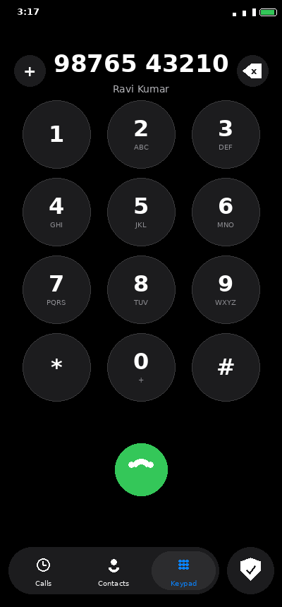
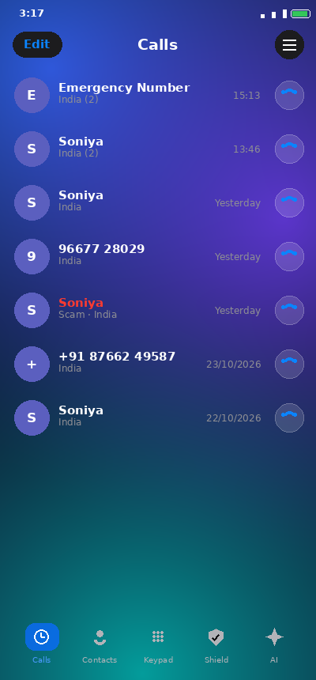
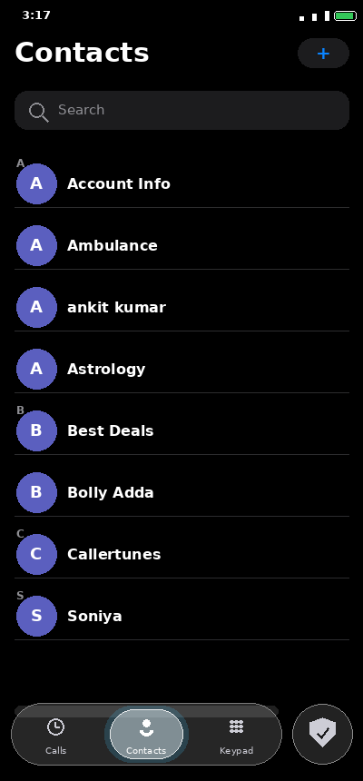
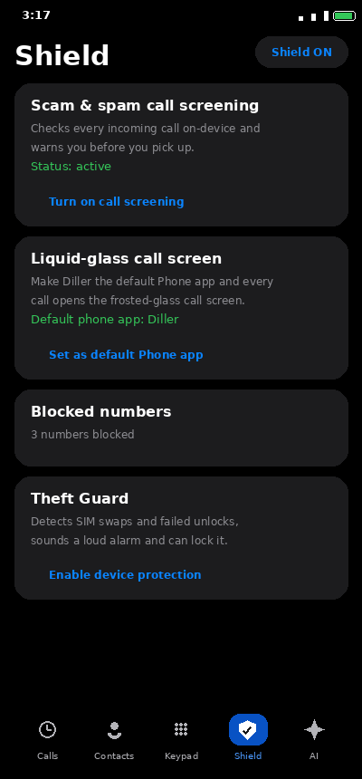
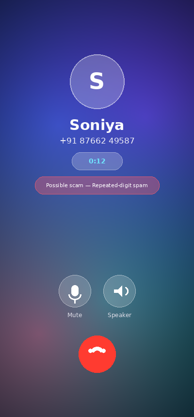

# Diller

**An iOS-style Android dialer with on-device scam screening, a theft guard, and a liquid-glass call screen.**

No ads. No account. No sign-in. Everything runs on your phone — your calls, contacts and blocklist never leave the device.

> ### ⬇️ [Download Diller.apk](https://github.com/technicalnihilist-lgtm/diller/releases/latest/download/Diller.apk)
> Latest release — v2.1.0. Also available as a file in this repo: [`Diller.apk`](Diller.apk).

<p align="center">
  
  
  
</p>
<p align="center">
  
  
</p>

> Screenshots above are design renders of the current build (see `screenshots/device/` for real device photos of the earlier 1.0 build).

## Features

- **iPhone-style dialer** — black background, circular dark-grey keys, green call button, and a rounded **Calls / Contacts / Keypad** bar with a round **Shield** button.
- **Liquid-glass call screen** — a frosted, animated glass screen shown while you're on a call: contact, number, live call state (Calling… / Incoming call / running timer), a scam warning, Mute / Speaker, and a red hang-up. Works for incoming *and* outgoing calls.
- **Scam & spam call screening** — a `CallScreeningService` inspects every incoming call on-device and warns you before you pick up. Suspicious callers are tagged red in the call list.
- **Blocklist** — add numbers; blocked callers are rejected automatically.
- **Theft Guard** — detects a SIM-card swap or repeated failed unlock attempts, sounds a loud alarm, and (with device-admin) can lock the device. Restarts after reboot.
- **Missed-call filter**, search, and a clean call log.

## Install

Download **[Diller.apk](https://github.com/technicalnihilist-lgtm/diller/releases/latest/download/Diller.apk)**, copy it to your phone, and tap it. Allow *"install from this source"* when Android asks, then open Diller and grant the permissions.

- Package: `com.diller.app`
- Version: 2.1.0 (versionCode 3) · Min Android 8.0 (API 26) · Target Android 14 (API 34)
- Signed with APK Signature Scheme v2 + v3 (self-signed — not a Play Store listing).

## Making Diller your default Phone app (needed for the call screen)

Android only lets an app show **its own in-call screen if it is the default Phone app**. If another dialer is set as default, pressing call hands the call to *that* dialer and Diller's screen won't appear.

Open Diller — the Keypad shows a **"Set Diller as your default Phone app"** banner until you switch. Tap it and pick **Diller**. From then on every call opens Diller's liquid-glass call screen.

Diller qualifies for the role: it handles the `ACTION_DIAL` intent and implements an `InCallService` with both incoming and ongoing call UI.

## How the scam detection works

On-device and heuristic: your blocklist, high-risk international prefixes, telemarketing/promotional series (140, 1800), premium-rate numbers (0900), and repeated/sequential digit patterns — scored 0–100.

It does **not** query a global crowd-sourced scammer database (that needs a network service/account, which this app deliberately avoids), so a brand-new scam number with a normal pattern won't be flagged until you block it. Nothing about your calls leaves the phone.

## Build from source

Plain Android app — **no Gradle**. `build.sh` drives the SDK build-tools directly:

```
aapt2 compile → aapt2 link (+R.java) → javac → d8 → zip → zipalign → apksigner
```

Requirements: JDK 17 (`JAVA_HOME`) and an Android SDK (`ANDROID_HOME`) with `build-tools;34.0.0` and `platforms;android-34`. Then:

```bash
bash build.sh
# → build/Diller.apk
```

The signing key (`diller.keystore`, password `dillerpass`) is generated on first build if missing — keep it so updates install over the top.

## Project layout

```
app/AndroidManifest.xml
app/res/…                        layouts, drawables, iOS theme, adaptive icon
app/src/com/diller/app/
    MainActivity.java            tabs, keypad, calls, contacts, shield, roles, banner
    InCallActivity.java          liquid-glass call screen (state + timer + mute/speaker)
    DillerInCallService.java     InCallService — telecom bridge + full-screen fallback
    DillerScreeningService.java  CallScreeningService — scam/spam screening
    SpamEngine.java              on-device scoring + blocklist
    TheftGuardService.java       foreground anti-theft watchdog + alarm
    AdminReceiver.java           device-admin: failed-unlock alarm, lock/wipe
    BootReceiver.java            restarts Theft Guard after reboot
    GlassBackgroundView.java     animated glass backdrop
    Contacts.java                reverse number lookup
build.sh                         the build pipeline
screenshots/                     design renders + device photos
Diller.apk                       ready-to-install build
```

## Notes

- Self-signed build, not distributed through the Play Store.
- `screenshots/` shows design renders of the current build plus real device photos of the earlier 1.0 build.

## License

MIT — see [LICENSE](LICENSE).
