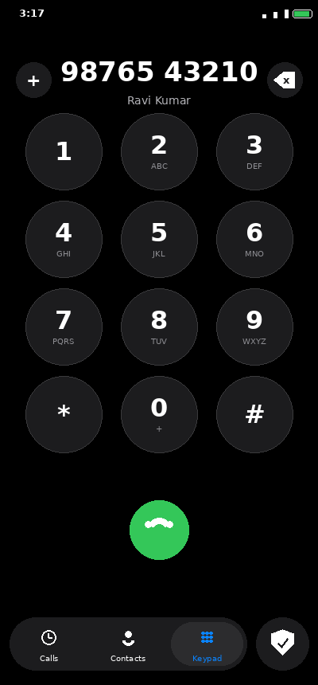
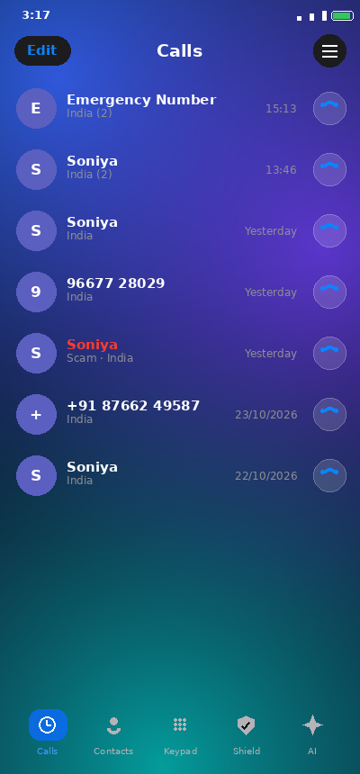
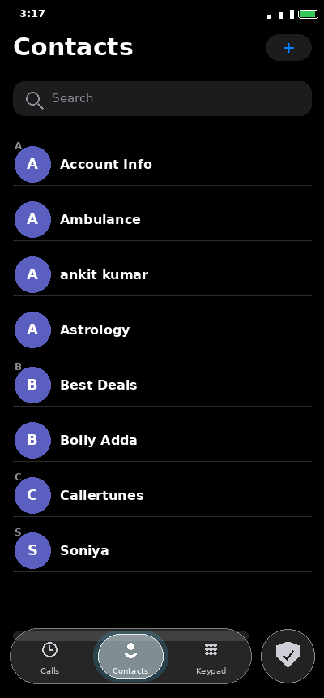
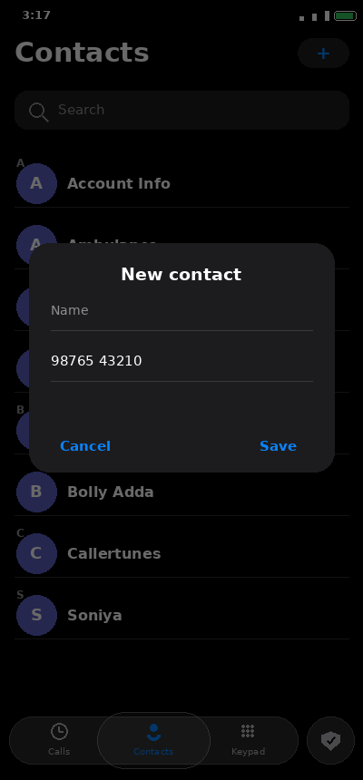
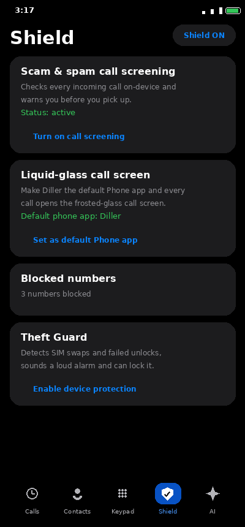
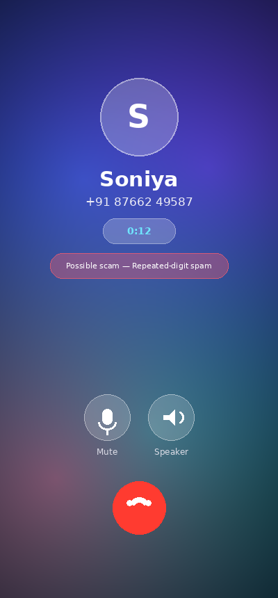

# Diller

**An iOS-style Android dialer with on-device scam screening, a theft guard, and a liquid-glass call screen.**

No ads. No account. No sign-in. Everything runs on your phone — your calls, contacts and blocklist never leave the device.

> ### ⬇️ [Download Diller.apk](https://github.com/technicalnihilist-lgtm/diller/releases/latest/download/Diller.apk)
> Latest release — v3.1.0. Also available as a file in this repo: [`Diller.apk`](Diller.apk).

<p align="center">
  
  
  
</p>
<p align="center">
  
  
  
</p>

> Screenshots above are design renders of the current build (see `screenshots/device/` for real device photos of the earlier 1.0 build).

## What's new in 3.1.0

- **Built-in key support.** `AiConfig` now falls back to a `BuiltinKey` class if the user hasn't saved a key, so a personal build can ship with the AI already working — no setup screen.
- `BuiltinKey.java` is **gitignored**: it is generated only for personal builds and never lands in this public repo.
- The public APK here still ships **without** a key (a key in a public repo would be extracted and abused). Paste your own key in **AI → AI settings**.

## What's new in 3.0.1

- **Fixed the AI model name** — the default was `sarvam-m`, which does not exist on Sarvam's API, so chat failed even with a valid key. Now `sarvam-105b-conversations`.
- **Translation** now sends `model: mayura:v1`, matching Sarvam's `/translate` endpoint.
- Verified against the live API: chat and translate both return 200.

## What's new in 3.0.0 — AI

A new **AI tab** (5th tab) with:

- **Today's call summary** — real numbers from your call log: total calls (outgoing / incoming / missed), talk time, and who you spoke to most ("Soniya — 3 baar"). Runs fully on-device, no key needed.
- **Ask AI** — a chat box wired to your AI provider.
- **Translate** — type text, cycle the target language (Hindi, Bengali, Tamil, Telugu, Marathi, Gujarati, Kannada, Malayalam), translate.
- **AI call agent** — when enabled, Diller answers calls from unknown or suspected-spam numbers on your behalf and records each one.
- **AI history** — local log of every question, translation and call the agent handled.

### Setting up the AI

No model is bundled, so chat and translation need an API key. Open **AI → "AI settings (API key)"** and enter **provider** (`sarvam` or `openai`), your **API key**, **base URL** (default `https://api.sarvam.ai`) and **model** (default `sarvam-m`). Without a key, the call summary and history still work.

### What is NOT possible on Android

Android blocks third-party access to call audio, so two requested features cannot be built by any sideloaded app:

- **Live captions of the other person** — no app gets an audio stream of a call (only the system's Live Caption can).
- **A real two-way AI voice agent** that listens and speaks to the caller — injecting TTS into a call and recording the caller need system privileges.

The AI agent here therefore **answers and logs** the call; it cannot converse.

## What's new in 2.9.0 — iOS 26 Liquid Glass

- **Colourful wallpaper backdrop** so the glass has something to refract (glass on pure black just looks grey).
- **Frosted glass keypad**, **glass dock**, **glass cards** with thin bright rims.

## What's new in 2.8.0

- **Bottom bar matched to the Galaxy-Store-style reference**: four tabs in one bar, **no bar background** (the icons float), and the selected tab sits in a **solid blue capsule** with a **white icon** and a **blue label** — exactly the treatment in the video.
- Action pills are now **blue-tinted glass** instead of neutral.

## What's new in 2.7.0

- **Lens corrected against the video's pixels.** My earlier lens was far too bright (a near-white blob). Measured from the frame, the lens is only ~7% lighter than the bar with a **thin bright rim** — so it now reads as a subtle frosted capsule, exactly like the reference.
- **Proportions fixed**: lens ≈ **1.19×** the item width and **1.19×** the bar height (it was 1.35× before), protruding ~5dp above and below.
- Bar tone matched to the sampled value (~15% white).

## What's new in 2.6.0

- **Bottom bar rebuilt to match the reference frame-for-frame** (measured from the video): a glass **pill holding three tabs** (Calls, Contacts, Keypad) plus a **separate glass circle** for Shield — exactly the video's layout.
- The selected tab gets a **stadium-shaped glass lens** that is ~1.35× the bar height and spills past the bar's top and bottom edges, with a soft (not bright) rim.
- **Blue icon + label** on the selected tab, soft grey on the rest; the lens scales in when you switch.
- Bar/lens tones were sampled from the video (bar ≈13% white, lens ≈22%) so it reads the same.

## What's new in 2.5.0

- **The tab bar now matches the liquid-glass reference.** All four tabs (Calls, Contacts, Keypad, Shield) live in **one floating glass pill**, and the selected tab sits in a **circular glass lens** that is larger than the bar and spills past its edges — with a **blue** icon and label, exactly like the video.
- **Swipe to switch tabs.** Drag left/right anywhere on the screen (including on the bar itself) to move between Calls → Contacts → Keypad → Shield, with a slide animation. Vertical scrolling is unaffected, and a swipe started on a call/contact row still does call/delete.

## What's new in 2.4.0

- **Liquid-glass bottom bar.** The tab bar is now a floating, frosted-glass pill instead of a flat black block — translucent with a bright rim, and the **selected tab sits in a raised glass capsule with a soft cyan glow**. The Shield button is a glass circle too.

## What's new in 2.3.1

- **Swipe gestures actually work now.** 2.3.0 attached the swipe listener to list rows, but ListView rows are not clickable by default, so a row never became the touch target and never received the drag events — the gesture could not fire. Rows are now clickable and own the whole gesture, and taps are handled by the same listener. Swipe **right to call**, **left to delete** (calls immediately, contacts after a confirm).

## What's new in 2.3.0

- **Swipe actions on lists.** In **Calls** and **Contacts**, swipe a row **right to call** that person, or **left to delete** it — a call-log entry is removed immediately, and deleting a contact asks for confirmation first. Vertical scrolling still works normally.

## What's new in 2.2.0

- **Speaker & volume fixed.** The Speaker button now changes the real call audio route (via the Telecom `InCallService`), not just the deprecated system flag — so it actually switches to loudspeaker. Call volume is pushed to maximum when a call connects and when you enable speaker. Mute now uses the proper in-call mute too.
- **Contacts built in.** Adding a contact opens a Diller dialog (name + number) and saves straight to the device — no bouncing out to another contacts app. There's a **+** button on the Contacts tab as well as the keypad's add button.
- **Smaller, iOS-style dial pad.** Keys are now compact circles with generous spacing instead of edge-to-edge tiles.

## Features

- **iPhone-style dialer** — black background, circular dark-grey keys, green call button, and a rounded **Calls / Contacts / Keypad** bar with a round **Shield** button.
- **Liquid-glass call screen** — a frosted, animated glass screen shown while you're on a call: contact, number, live call state (Calling… / Incoming call / running timer), a scam warning, Mute / Speaker, and a red hang-up. Works for incoming *and* outgoing calls.
- **Scam & spam call screening** — a `CallScreeningService` inspects every incoming call on-device and warns you before you pick up. Suspicious callers are tagged red in the call list.
- **Blocklist** — add numbers; blocked callers are rejected automatically.
- **Built-in contact creation** — create contacts inside Diller.
- **Swipe to call / delete** — swipe a row right to call, left to delete (calls or contacts).
- **Swipe to switch tabs** — drag left/right on the screen or the bar.
- **Theft Guard** — detects a SIM-card swap or repeated failed unlock attempts, sounds a loud alarm, and (with device-admin) can lock the device. Restarts after reboot.
- **Missed-call filter**, search, and a clean call log.

## Install

Download **[Diller.apk](https://github.com/technicalnihilist-lgtm/diller/releases/latest/download/Diller.apk)**, copy it to your phone, and tap it. Allow *"install from this source"* when Android asks, then open Diller and grant the permissions.

- Package: `com.diller.app`
- Version: 3.1.0 (versionCode 15) · Min Android 8.0 (API 26) · Target Android 14 (API 34)
- Signed with APK Signature Scheme v2 + v3 (self-signed — not a Play Store listing).

## Making Diller your default Phone app (needed for the call screen)

Android only lets an app show **its own in-call screen if it is the default Phone app**. If another dialer is set as default, pressing call hands the call to *that* dialer and Diller's screen won't appear.

Open Diller — the Keypad shows a **"Set Diller as your default Phone app"** banner until you switch. Tap it and pick **Diller**. From then on every call opens Diller's liquid-glass call screen.

Diller qualifies for the role: it handles the `ACTION_DIAL` intent and implements an `InCallService` with both incoming and ongoing call UI.

## How the scam detection works

On-device and heuristic: your blocklist, high-risk international prefixes, telemarketing/promotional series (140, 1800), premium-rate numbers (0900), and repeated/sequential digit patterns — scored 0–100.

It does **not** query a global crowd-sourced scammer database (that needs a network service/account, which this app deliberately avoids), so a brand-new scam number with a normal pattern won't be flagged until you block it. Nothing about your calls leaves the phone.

## Build from source

Plain Android app — **no Gradle**. `build.sh` drives the SDK build-tools directly:

```
aapt2 compile → aapt2 link (+R.java) → javac → d8 → zip → zipalign → apksigner
```

Requirements: JDK 17 (`JAVA_HOME`) and an Android SDK (`ANDROID_HOME`) with `build-tools;34.0.0` and `platforms;android-34`. Then:

```bash
bash build.sh
# → build/Diller.apk
```

The signing key (`diller.keystore`, password `dillerpass`) is generated on first build if missing — keep it so updates install over the top.

## Project layout

```
app/AndroidManifest.xml
app/res/…                        layouts, drawables, iOS theme, adaptive icon
app/src/com/diller/app/
    MainActivity.java            tabs, keypad, calls, contacts, shield, roles, banner
    InCallActivity.java          liquid-glass call screen (state + timer + audio routing)
    DillerInCallService.java     InCallService — telecom bridge + full-screen fallback
    DillerScreeningService.java  CallScreeningService — scam/spam screening
    SpamEngine.java              on-device scoring + blocklist
    TheftGuardService.java       foreground anti-theft watchdog + alarm
    AdminReceiver.java           device-admin: failed-unlock alarm, lock/wipe
    BootReceiver.java            restarts Theft Guard after reboot
    GlassBackgroundView.java     animated glass backdrop
    Contacts.java                reverse number lookup
build.sh                         the build pipeline
screenshots/                     design renders + device photos
Diller.apk                       ready-to-install build
```

## Notes

- Self-signed build, not distributed through the Play Store.
- `screenshots/` shows design renders of the current build plus real device photos of the earlier 1.0 build.

## License

MIT — see [LICENSE](LICENSE).

---

## ⭐ Like this work? Give it a star

If you like this app and our work, please **star this repository** ⭐ and **[follow technicalnihilist-lgtm on GitHub](https://github.com/technicalnihilist-lgtm)**. If our work isn't for you, that's completely fine — the choice is yours. Thank you for stopping by!

<details>
<summary><b>🌍 Same message in 32 languages (A–Z + Indian languages)</b></summary>

- **A — Arabic** (العربية): ⭐ إذا أعجبك هذا التطبيق وعملنا، فيرجى منح المستودع نجمة ومتابعتنا. وإذا لم يعجبك عملنا، فلا مشكلة على الإطلاق — القرار قرارك. شكرًا لزيارتك!
- **B — Bengali** (বাংলা): ⭐ যদি আপনার এই অ্যাপ এবং আমাদের কাজ ভালো লাগে, তবে অনুগ্রহ করে রিপোজিটরিটিকে একটি স্টার দিন এবং আমাদের ফলো করুন। আমাদের কাজ যদি আপনার পছন্দ না হয়, তাতেও কোনো সমস্যা নেই — সিদ্ধান্ত আপনার। আমাদের পেজে আসার জন্য ধন্যবাদ!
- **C — Chinese** (中文): ⭐ 如果你喜欢这个应用和我们的作品，请给仓库点个星标并关注我们。如果我们的作品不适合你，也完全没关系——选择权在你。感谢你的到访！
- **D — Dutch** (Nederlands): ⭐ Vind je deze app en ons werk leuk? Geef de repository dan een ster en volg ons. Vind je ons werk niets, dan is dat helemaal prima — de keuze is aan jou. Bedankt voor je bezoek!
- **E — English** (English): ⭐ If you like this app and our work, please give the repository a star and follow us. If our work isn't for you, that's completely fine — the choice is yours. Thank you for stopping by!
- **F — French** (Français): ⭐ Si cette application et notre travail vous plaisent, mettez une étoile au dépôt et suivez-nous. Si notre travail n'est pas pour vous, aucun souci — c'est votre choix. Merci de votre visite !
- **G — German** (Deutsch): ⭐ Wenn dir diese App und unsere Arbeit gefallen, gib dem Repository einen Stern und folge uns. Wenn unsere Arbeit nichts für dich ist, ist das völlig in Ordnung — die Wahl liegt bei dir. Danke fürs Vorbeischauen!
- **H — Hindi** (हिन्दी): ⭐ अगर आपको यह ऐप और हमारा काम पसंद है, तो कृपया रिपॉजिटरी को स्टार दें और हमें फॉलो करें। अगर हमारा काम आपके लिए नहीं है, तो भी कोई बात नहीं — यह पूरी तरह आपकी मर्ज़ी है। यहाँ आने के लिए आपका धन्यवाद!
- **I — Indonesian** (Bahasa Indonesia): ⭐ Jika kamu suka aplikasi ini dan karya kami, beri bintang pada repositori ini dan ikuti kami. Kalau karya kami bukan untukmu, tidak masalah sama sekali — itu pilihanmu. Terima kasih sudah mampir!
- **J — Japanese** (日本語): ⭐ このアプリと私たちの仕事が気に入ったら、リポジトリにスターを付けてフォローしてください。合わない場合はまったく問題ありません — 選ぶのはあなたです。お越しいただきありがとうございます！
- **K — Korean** (한국어): ⭐ 이 앱과 저희 작업이 마음에 드신다면 저장소에 스타를 눌러 주시고 팔로우해 주세요. 저희 작업이 맞지 않으셔도 전혀 괜찮습니다 — 선택은 여러분의 몫입니다. 방문해 주셔서 감사합니다!
- **L — Lithuanian** (Lietuvių): ⭐ Jei tau patinka ši programa ir mūsų darbas, duok saugyklai žvaigždutę ir sek mus. Jei mūsų darbas ne tau, viskas gerai — pasirinkimas tavo. Ačiū, kad užsukai!
- **M — Malayalam** (മലയാളം): ⭐ നിങ്ങൾക്ക് ഈ ആപ്പും ഞങ്ങളുടെ പ്രവർത്തനവും ഇഷ്ടപ്പെട്ടെങ്കിൽ, ദയവായി റെപ്പോസിറ്ററിക്ക് ഒരു സ്റ്റാർ നൽകുകയും ഞങ്ങളെ ഫോളോ ചെയ്യുകയും ചെയ്യുക. ഞങ്ങളുടെ പ്രവർത്തനം നിങ്ങൾക്ക് അനുയോജ്യമല്ലെങ്കിൽ, അതും തികച്ചും കുഴപ്പമില്ല — തീരുമാനം നിങ്ങളുടേതാണ്. ഇവിടെ വന്നതിന് നന്ദി!
- **N — Nepali** (नेपाली): ⭐ यदि तपाईंलाई यो एप र हाम्रो काम मन पर्‍यो भने, कृपया रिपोजिटरीलाई स्टार दिनुहोस् र हामीलाई फलो गर्नुहोस्। यदि हाम्रो काम तपाईंलाई मन पर्दैन भने, पनि ठीकै छ — यो तपाईंको इच्छा हो। यहाँ आउनुभएकोमा धन्यवाद!
- **O — Odia** (ଓଡ଼ିଆ): ⭐ ଯଦି ଆପଣଙ୍କୁ ଏହି ଆପ୍ ଏବଂ ଆମର କାମ ଭଲ ଲାଗୁଛି, ତେବେ ଦୟାକରି ରିପୋଜିଟୋରୀକୁ ଗୋଟିଏ ଷ୍ଟାର୍ ଦିଅନ୍ତୁ ଏବଂ ଆମକୁ ଫଲୋ କରନ୍ତୁ। ଯଦି ଆମର କାମ ଆପଣଙ୍କ ପାଇଁ ନୁହେଁ, ତେବେ କିଛି ଅସୁବିଧା ନାହିଁ — ପସନ୍ଦ ଆପଣଙ୍କର। ଆମ ପାଖକୁ ଆସିଥିବାରୁ ଧନ୍ୟବାଦ!
- **P — Polish** (Polski): ⭐ Jeśli podoba Ci się ta aplikacja i nasza praca, daj repozytorium gwiazdkę i obserwuj nas. Jeśli nasza praca nie jest dla Ciebie, to zupełnie w porządku — wybór należy do Ciebie. Dziękujemy za odwiedziny!
- **Q — Quechua** (Runa Simi): ⭐ Kay app, ñuqaykup ruwasqanchikpas gustasunki chayqa, repositorioman huk estrella churay, ñuqaykutapas qatipayku. Mana gustasunki chayqa, allinmi — qampa akllayki. Hamusqaykimanta sulpayki!
- **R — Russian** (Русский): ⭐ Если вам нравится это приложение и наша работа, поставьте звёздочку репозиторию и подпишитесь на нас. Если наша работа не для вас — это совершенно нормально, выбор за вами. Спасибо, что заглянули!
- **S — Spanish** (Español): ⭐ Si te gusta esta app y nuestro trabajo, dale una estrella al repositorio y síguenos. Si nuestro trabajo no es para ti, no pasa nada — la decisión es tuya. ¡Gracias por pasarte!
- **T — Tamil** (தமிழ்): ⭐ உங்களுக்கு இந்த ஆப்பும் எங்க வேலையும் பிடிச்சிருந்தா, தயவுசெஞ்சு இந்த ரெபாசிட்டரிக்கு ஒரு ஸ்டார் குடுத்து, எங்களை ஃபாலோ பண்ணுங்க. எங்க வேலை உங்களுக்கு செட் ஆகலைன்னாலும் பரவாயில்லை — அது உங்க விருப்பம். இங்கே வந்ததுக்கு நன்றி!
- **U — Urdu** (اردو): ⭐ اگر آپ کو یہ ایپ اور ہمارا کام پسند آئے تو براہ کرم ریپازٹری کو سٹار دیں اور ہمیں فالو کریں۔ اگر ہمارا کام آپ کے لیے نہیں ہے، تو یہ بالکل ٹھیک ہے — انتخاب آپ کا ہے۔ یہاں تشریف لانے کا شکریہ!
- **V — Vietnamese** (Tiếng Việt): ⭐ Nếu bạn thích ứng dụng này và công việc của chúng tôi, hãy tặng kho lưu trữ một ngôi sao và theo dõi chúng tôi. Nếu công việc của chúng tôi không phù hợp với bạn, điều đó hoàn toàn ổn — lựa chọn là của bạn. Cảm ơn bạn đã ghé qua!
- **W — Welsh** (Cymraeg): ⭐ Os ydych chi'n hoffi'r ap hwn a'n gwaith, rhowch seren i'r storfa a dilynwch ni. Os nad yw ein gwaith ar eich cyfer, mae hynny'n hollol iawn — chi sydd i benderfynu. Diolch am alw heibio!
- **X — Xhosa** (isiXhosa): ⭐ Ukuba uyayithanda le app nomsebenzi wethu, nika irepo inkwenkwezi kwaye usilandele. Ukuba umsebenzi wethu awukufanelanga, akukho ngxaki — lukhetho lwakho. Enkosi ngokutyelela!
- **Y — Yoruba** (Yorùbá): ⭐ Bí app yìí àti iṣẹ́ wa bá wù ọ́, jọ̀wọ́ fún àkójọpọ̀ náà ní ìràwọ̀ kí o sì tẹ̀lé wa. Bí iṣẹ́ wa kò bá yẹ ọ́, kò séwu — ìwọ ni ó yàn. Ẹ ṣé fún wíwá!
- **Z — Zulu** (isiZulu): ⭐ Uma uthanda le app nomsebenzi wethu, nikeza isitoreji inkanyezi bese usilandela. Uma umsebenzi wethu ungakufanele, akunankinga — wukukhetha kwakho. Siyabonga ngokuvakasha!

**More Indian languages**

- **Assamese** (অসমীয়া): ⭐ যদি আপুনি এই এপটো আৰু আমাৰ কাম ভাল পায়, তেন্তে অনুগ্ৰহ কৰি ৰিপজিটৰীটোক এটা ষ্টাৰ দিয়ক আৰু আমাক ফ'ল' কৰক। যদি আমাৰ কাম আপোনাৰ বাবে নহয়, তেন্তে সেয়া একেবাৰে ঠিক আছে — সিদ্ধান্তটো আপোনাৰ। আমাৰ ইয়ালৈ অহাৰ বাবে ধন্যবাদ!
- **Gujarati** (ગુજરાતી): ⭐ જો તમને આ એપ અને અમારું કામ ગમતું હોય, તો પ્લીઝ રિપોઝિટરીને સ્ટાર આપો અને અમને ફોલો કરો. જો અમારું કામ તમને ન ગમતું હોય, તો તે પણ બરાબર છે — પસંદગી તમારી છે. અહીં આવવા બદલ આભાર!
- **Kannada** (ಕನ್ನಡ): ⭐ ನಿಮಗೆ ಈ ಆ್ಯಪ್ ಮತ್ತು ನಮ್ಮ ಕೆಲಸ ಇಷ್ಟವಾದರೆ, ದಯವಿಟ್ಟು ರೆಪೊಸಿಟರಿಗೆ ಸ್ಟಾರ್ ಕೊಡಿ ಮತ್ತು ನಮ್ಮನ್ನು ಫಾಲೋ ಮಾಡಿ. ನಮ್ಮ ಕೆಲಸ ನಿಮಗೆ ಸರಿಹೊಂದದಿದ್ದರೆ, ಅದೂ ಪರವಾಗಿಲ್ಲ — ಆಯ್ಕೆ ನಿಮ್ಮದು. ಭೇಟಿ ನೀಡಿದ್ದಕ್ಕೆ ಧನ್ಯವಾದಗಳು!
- **Marathi** (मराठी): ⭐ जर तुम्हाला हे ॲप आणि आमचं काम आवडलं असेल, तर कृपया रिपॉझिटरीला स्टार द्या आणि आम्हाला फॉलो करा. जर आमचं काम तुम्हाला आवडत नसेल, तर काही हरकत नाही — ती तुमची निवड आहे. इथे आल्याबद्दल धन्यवाद!
- **Punjabi** (ਪੰਜਾਬੀ): ⭐ ਜੇ ਤੁਹਾਨੂੰ ਇਹ ਐਪ ਅਤੇ ਸਾਡਾ ਕੰਮ ਪਸੰਦ ਹੈ, ਤਾਂ ਕਿਰਪਾ ਕਰਕੇ ਰਿਪੋਜ਼ਟਰੀ ਨੂੰ ਸਟਾਰ ਦਿਓ ਅਤੇ ਸਾਨੂੰ ਫਾਲੋ ਕਰੋ। ਜੇ ਸਾਡਾ ਕੰਮ ਤੁਹਾਡੇ ਲਈ ਨਹੀਂ ਹੈ, ਤਾਂ ਕੋਈ ਗੱਲ ਨਹੀਂ — ਚੋਣ ਤੁਹਾਡੀ ਹੈ। ਸਾਡੇ ਪੇਜ 'ਤੇ ਆਉਣ ਲਈ ਧੰਨਵਾਦ!
- **Telugu** (తెలుగు): ⭐ మీకు ఈ యాప్, మా పని నచ్చితే, దయచేసి రిపోజిటరీకి ఒక స్టార్ ఇచ్చి మమ్మల్ని ఫాలో అవ్వండి. ఒకవేళ మా పని మీకు నచ్చకపోతే, పర్వాలేదు — అది మీ ఇష్టం. మమ్మల్ని సందర్శించినందుకు ధన్యవాదాలు!

</details>
